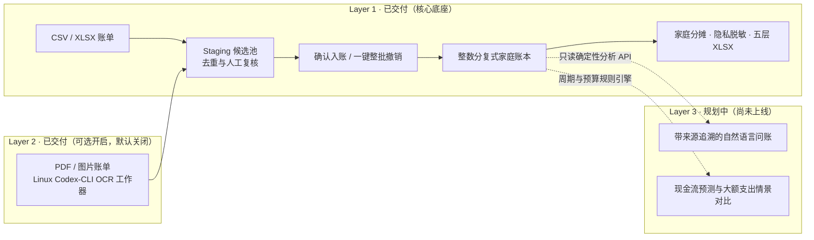

# HomeDatabase · 自托管家庭复式账本（迈向家庭 AI CFO 的可核对财务底座）

<div align="center">

**导错一份账单也不会污染账本：用「Staging 候选池复核 + 一键整批撤销 + 整数分复式分录 + 家庭隐私隔离与分摊确认」，把散落的日常账单变成经得起核对的家庭财务记录。**

[](https://github.com/Kaiserunix/homedatabase/actions/workflows/backend-ci.yml)
[](https://github.com/Kaiserunix/homedatabase/actions/workflows/frontend-ci.yml)

`Self-hosted` · `Double-Entry Integer Cents` · `Human-Confirmed Staging` · `Full-Batch Undo` · `AI CFO Roadmap`

[30 秒虚构账本体验](#快速体验30-秒虚构账本) · [产品策略与路线图](docs/PRODUCT_STRATEGY.md) · [接入自己的数据](docs/CONNECT_YOUR_DATA.md) · [AI 未来蓝图](docs/AI_ROADMAP.md) · [演示脚本](docs/SUBMISSION.md)

</div>

---

家庭财务信息分散在银行、支付软件、截图与表格里。多数记账方案要么把敏感流水交给云端，要么在导入几百条账单出错后直接污染整本账，或者在“全家全透明”与“各自记死账”之间两难。

**HomeDatabase** 先把最难做对的财务底座做扎实——今天提供可独立运行、可复核、可整批回滚的自托管复式家庭账本（FastAPI / SQLAlchemy + React / Vite，本地试用 SQLite，正式部署 PostgreSQL），并以此作为迈向可溯源「家庭 AI CFO」的可靠数据基石。

> **能力边界诚实声明**：当前版本已交付完整的复式家庭账本、手机 PWA + 桌面管理台、CSV/XLSX 候选池导入、一键整批撤销、家庭分摊确认、五层 XLSX 审计报表，以及可选的账单 OCR 工作器（需单独配置 Linux Docker + `codex` CLI，默认关闭）。**自然语言问账、现金流预测与情景推演属于 Layer 3 规划能力，当前版本尚未提供对应入口。**

**公开脱敏版说明**：仓库内置的示例库从零生成，所有交易均为虚构，不包含真实流水、凭据、密钥或私人运行目录。

- [产品策略与演进优先级（共识路线图）](docs/PRODUCT_STRATEGY.md)
- [接入自己的数据：空库初始化、账单导入、API 与 PostgreSQL](docs/CONNECT_YOUR_DATA.md)
- [示例数据库与 CSV 模板](examples/README.md) · [公开数据范围与脱敏说明](docs/PUBLIC_DATA.md) · [服务器部署](infra/README.md)

---

## 为什么选择 HomeDatabase（已交付的核心优势）

| 维度 | 当前已交付能力 | 解决的真实痛点 |
| --- | --- | --- |
| 🛡️ **防污染导入闭环** | 源文件加密归档 → **Staging 候选池**（SHA-256 文件去重、行哈希去重、重复流水提示）→ `expectedVersion` 乐观锁防并发 → 入账后支持 **一键整批无痕撤销 (`undo_batch`)** | 告别“导错一份 CSV 就彻底毁掉账本”的恐惧（在未产生退款/分摊/锁账期前可一键整批回滚） |
| 🧾 **审计级复式底座** | **整数分 (`minor`)** 记账 + PostgreSQL 延迟借贷平衡触发器 + 账期锁定 (`Locks`) | 消除浮点精度误差与单边烂账，保证每一笔流水借贷平衡 |
| 🔒 **隐私与家庭协作兼得** | 个人账户默认私密隔离，跨私有账户往来自动显示为 **`私人账户（已脱敏）`** 且保持复式平衡；**家庭分摊 (`Splits`)** 需对方点击「接受 / 退回理由」，原金额改动自动触发 `v2` 重新确认 | 既保留家庭公共账本透明，又尊重各自私房钱边界，避免单方面分摊纠纷 |
| 📊 **五层审计级 XLSX 导出** | 后端 PostgreSQL `REPEATABLE READ` 事务快照 + 借贷平衡校验 + 防公式注入，输出从阅读账单、复式分录到 **Tier 4 期初/期末零差额勾稽** 与图表总览的 5 层工作簿 | 比算不准的前端图表更可靠，随时可离线归档审计 |
| 📱 **双端共用一套真实账本** | 手机 PWA（日常记账、导入与分摊确认）+ 桌面管理台（分类、账期锁、批量审核、报表与备份）+ WebAuthn Passkey | 家人用轻量手机端，家庭管理员在桌面端精细治理 |

---

## 三层演进架构：从可信账本走向可溯源 AI CFO

这条路线的核心原则是：**AI 输出永远先过可信账本与人工复核，不凭空编造数字。**



| 层次 | 能力范围 | 当前状态 |
| --- | --- | --- |
| **Layer 1 · 可核对的家庭复式账本** | 自托管账本、手机 PWA / 桌面管理台、CSV/XLSX 候选池导入与整批撤销、家庭分摊确认、五层 XLSX 报表、WebAuthn 与加密备份 | ✅ **当前可用** |
| **Layer 2 · 候选池 AI 账单识别工作器** | PDF / 图片提取为结构化候选记录，经用户复核确认后入账（绝不自动写入正式账本） | ⚙️ **已提供工作器**（需单独配置 Linux Docker + `codex` CLI，默认关闭） |
| **Layer 3 · 带证据溯源的 AI CFO** | 先建确定性只读财务分析 API，再接入带交易来源引用的自然语言问账、周期支出识别、现金流预测与情景推演 | 🔭 **规划中（当前无对应入口）** |

详细的目标体验、落地路径与验证标准见 [AI 未来蓝图](docs/AI_ROADMAP.md) 与 [产品策略与演进优先级](docs/PRODUCT_STRATEGY.md)。

---

## 快速体验（30 秒虚构账本）

准备 Python 3.12+、[uv](https://docs.astral.sh/uv/getting-started/installation/)、Node.js 22+ 和 Git。以下命令可在 PowerShell、Bash 或 zsh 中执行。

### 方式 A：先用虚构账本立即体验（推荐首次试用）

无需构思三套密码，初始化脚本会直接生成带 6 笔虚构流水的本地 SQLite 演示库，并在终端打印一次性随机密码：

```sh
git clone https://github.com/Kaiserunix/homedatabase.git
cd homedatabase/backend
uv sync --locked --group dev
uv run python scripts/setup_local.py --mode demo --directory data/demo
uv run --env-file data/demo/.env uvicorn homedatabase_api.main:app --app-dir src --host 127.0.0.1 --port 8000
```

再打开第二个终端，从仓库根目录启动前端：

```sh
cd frontend
npm ci --no-audit --no-fund
npm run dev -- --host 127.0.0.1
```

打开 [手机端 PWA](http://localhost:5200/) 或 [桌面管理台](http://localhost:5200/admin.html) 登录体验（前端默认通过 `/api` 直连本地后端，不需要配置 mock 或 Redis）。

> [!IMPORTANT]
> **首次试用 3 个关键提示（避免踩坑）：**
> 1. **🔑 首次请点「密码登录」**：登录页默认优先展示 `使用 Passkey 登录` 大按钮。全新初始化的账号尚未绑定 Passkey，请先点击按钮下方的 **「密码登录 ⌄」** 展开密码框，输入终端打印的随机密码（登录后可在“安全”页绑定 Passkey）。
> 2. **📅 演示账目位于 `2026-08 ~ 2026-09`**：手机首页与桌面仪表盘默认汇总**当前自然月**，若当前不在 2026 年 8–9 月，首页显示 `¥0.00` 属正常现象；进入「流水」或「报表导出」切换至 `2026-08` / `2026-09` 即可看到完整演示数据。
> 3. **👨‍👩‍👦 V1 固定三角色模板**：当前数据库 Schema 预置 `dad`、`mom`、`son` 三个成员账号，其中 **`son` 为唯一可访问 `/admin.html` 桌面管理台的家庭管理员**（二人世界/夫妻家庭建议直接使用 `son` 作为主理人账号、`mom` 或 `dad` 作为伴侣账号；动态成员增删已列入后续路线图）。

### 方式 B：初始化自己的空账本（本地个人试用）

正式记录自有账单时，另建独立目录（初始化脚本会拒绝覆盖已存在的目录）：

```sh
cd homedatabase/backend
uv run python scripts/setup_local.py --mode personal --directory data/personal
uv run --env-file data/personal/.env uvicorn homedatabase_api.main:app --app-dir src --host 127.0.0.1 --port 8000
```

脚本会交互式设置 `dad`、`mom`、`son` 的独立密码（至少 12 位且互不相同），创建空账本、默认人民币账户与分类，并生成两把本地加密密钥。公网/服务器部署请使用 PostgreSQL + HTTPS，详见 [infra/README.md](infra/README.md)。

---

## 导入自己的账单（Staging 候选复核流程）

1. 登录账号，在“账户”中创建或选择对应的人民币账户（桌面端完整管理功能请使用 `son` 管理员账号登录 `/admin.html`）。
2. 手机端从“我的 → 导入账单”，或桌面端打开“导入”页面。
3. 上传 CSV / XLSX 文件并选择目标账户，系统先加密归档源文件并生成候选记录。
4. 在候选区**核对日期、商户、金额、收支与去重状态，指定或修改分类、未设定的入账账户及外币汇率**，确认后写入正式账本（若确认入账后发现整批有误，且未涉及退款、分摊或已锁账期，可在批次详情中一键整批撤销）。

- 可直接填写 [CSV 空模板](examples/import-template.csv)，或参考 [虚构样例](examples/transactions.csv)。
- 表格金额单位为**元**，API 的 `amountCents` 单位为**分**。
- **当前限制说明**：候选区暂不支持在页面直接改写已解析的原始日期、金额或收支方向；微信/支付宝中性交易（转账、提现、信用卡还款）与退款的边界说明见 [自有数据接入说明](docs/CONNECT_YOUR_DATA.md)。
- **可选 OCR 识别**：默认本地启动不调用任何 AI。启用 PDF / 图片识别需按 [infra/README.md](infra/README.md) 部署可选 OCR 工作器（当前实现基于 Linux Docker + `codex` CLI）；启用后图片会发送至所配置模型提取为候选记录，仍须人工确认后入账。

---

## 已经可以验证的工程证据

- **可复现的测试与契约**：公开 OpenAPI 契约（[openapi.yaml](openapi.yaml)）、数据库迁移脚本、脱敏演示库检查与实时 CI（首次公开基线通过 101 项后端测试与 189 项前端测试，实时状态见顶部徽章）。
- **投稿与演示材料**：需要快速介绍项目或录制 3 分钟演示，可直接参考 [项目摘要、亮点与三分钟演示脚本](docs/SUBMISSION.md)。

### 本地验证命令

```sh
cd backend
uv run pytest
uv run python scripts/check_public_demo.py
cd ../frontend
npm run build
npm test
npm run test:budget
```

浏览器端到端测试另需启动真实后端并配置本地测试账号，见 `frontend/playwright.config.ts`。

## 仓库目录

```text
backend/       FastAPI 服务、SQLAlchemy 模型、迁移、测试与初始化脚本
frontend/      手机 PWA 与桌面管理台（React / Vite）
examples/      从零生成的虚构 SQLite 库、CSV 样例与空模板
infra/         PostgreSQL / Redis / Caddy 的 Docker Compose 部署模板
docs/          产品策略、AI 蓝图、自有数据接入、公开脱敏与演示说明
openapi.yaml   OpenAPI 契约定义
```

公开版仅收录当前前后端主版本；旧 Streamlit 原型与私人运行目录未包含在内。
