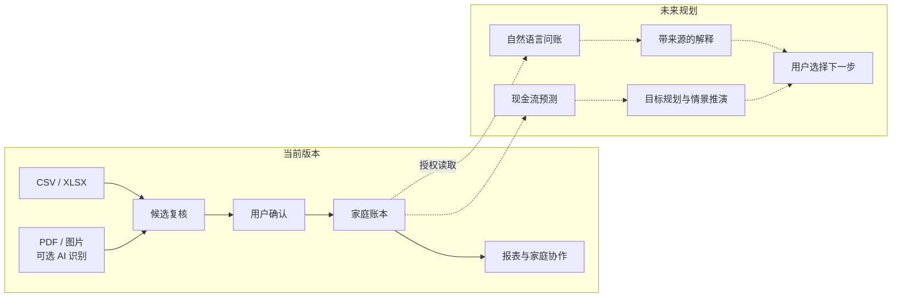

# HomeDatabase · 让每个家庭拥有自己的 AI CFO

<div align="center">

**把散落的账单，变成可以提问、可以推演、可以行动的家庭财务记忆。**

[](https://github.com/Kaiserunix/homedatabase/actions/workflows/backend-ci.yml)
[](https://github.com/Kaiserunix/homedatabase/actions/workflows/frontend-ci.yml)

`Self-hosted` · `AI-assisted Import` · `Human-confirmed Ledger` · `AI CFO Roadmap`

[快速体验](#本地启动) · [AI 未来蓝图](docs/AI_ROADMAP.md) · [投稿介绍与演示脚本](docs/SUBMISSION.md) · [接入自己的数据](docs/CONNECT_YOUR_DATA.md)

</div>

一张付款截图、一份银行流水、一笔家庭分摊，背后都藏着同一个问题：**我们的钱正在怎样改变生活？**

HomeDatabase 从一个能实际运行的家庭账本出发，向“家庭 AI 财务副驾”演进：今天，把分散的收支整理成可核对的记录；未来，让人们用一句话理解变化、比较计划、提前看见现金流压力。

当前版本提供手机 PWA、桌面管理台、账户与分类、账单导入、分摊、报表和备份，并提供可选的 AI 账单识别工作器。后端为 FastAPI / SQLAlchemy，前端为 React / Vite；本地试用使用 SQLite，正式部署使用 PostgreSQL。**AI CFO 是产品愿景；自然语言问账、预测和主动建议属于规划能力。**

**这是公开脱敏版：示例库从零生成，所有交易均为虚构，没有使用真实流水的日期、金额或对手方。** 仓库包含源码、迁移、测试、部署模板和示例数据，不包含运行中的数据库、原始账单、登录凭据、密钥或历史开发记录。

- [接入自己的数据：空库初始化、账单导入、API 和 PostgreSQL](docs/CONNECT_YOUR_DATA.md)
- [示例数据库与 CSV 模板](examples/README.md)
- [公开数据范围与脱敏说明](docs/PUBLIC_DATA.md)
- [服务器部署](infra/README.md) · [日常使用](docs/release/PARENTS_GUIDE.md)

## 为什么从家庭账本开始

家庭财务信息分散在银行、支付软件、截图与表格里。每个平台都能展示一部分数字，家庭成员仍然需要自己拼出完整的故事。

HomeDatabase 想把这段工作串起来：账单进入系统，数字得到核对，记录形成连续的历史，AI 再围绕这段历史回答真正影响生活的问题。

| 价值 | 当前落点 | 面向未来 |
| --- | --- | --- |
| 📥 降低记账门槛 | CSV / XLSX 导入；可配置的 PDF / 图片 AI 识别 | 多来源语义归一，让更多账单格式进入同一条复核流程 |
| 🧾 让数字有依据 | 整数金额、复式分录、候选确认、账期约束 | AI 回答带来源，计算过程可核对 |
| 🏠 让家人协作更自然 | 个人与共享账户、成员权限、分摊确认、手机与桌面入口 | 在授权范围内理解共同预算与长期目标 |
| 🔐 让数据由自己掌握 | 自托管数据库、加密源文件与备份、脱敏演示数据 | 按任务范围提供分析数据，探索本地模型适配 |

## AI 展望：从“记下一笔”，到“看见下一步”

我们希望家庭财务软件最终可以接住这样的问题：

> “这个月为什么多花了钱？把变化最大的三项和对应账单给我。”
>
> “如果年底旅行，再保留六个月应急金，每个月需要预留多少？”
>
> “换车、装修和提前还款，哪种安排对未来六个月现金流影响更大？”

**以上是规划中的交互示例，当前版本尚未提供问答或预测入口。**

这条路线的核心是把三件事连起来：**可信账本 → 有证据的理解 → 可比较的行动方案。**



| 阶段 | 能力 | 状态 |
| --- | --- | --- |
| **01 · 把账本建起来** | 自托管账本、手机 / 桌面端、导入确认、分摊与报表 | ✅ 当前可用 |
| **02 · 让 AI 读懂账单** | PDF / 图片提取为结构化候选，用户确认后入账 | ⚙️ 已提供工作器，需单独配置，默认关闭 |
| **03 · 让账本可以对话** | 自然语言问账、分类辅助、消费变化解释、来源追溯 | 🔭 规划中 |
| **04 · 看见未来的现金流** | 收支预测、周期性支出识别、预算偏离提醒 | 🔭 规划中 |
| **05 · 把愿望变成方案** | 应急金目标、旅行 / 大额消费计划、情景对比、可选月度复盘 | 🔭 长期探索 |

路线图以能力阶段组织，尚未承诺上线日期。详细的目标体验、落地路径与验证标准见 [AI 未来蓝图](docs/AI_ROADMAP.md)。

## 已经可以展示什么

**一条能演示、能复核的完整链路：导入账单 → 查看候选 → 确认入账 → 查看报表。**

- **真实可运行的产品骨架：** 手机 PWA 与桌面管理台连接同一套 API 和账本。
- **可选 AI 识别入口：** PDF / 图片经工作器提取字段，识别结果进入候选区；AI 输出与正式入账分开。
- **可复现的演示材料：** 从零生成的虚构数据库、CSV 样例和空模板，使用者可直接替换为自己的数据。
- **可检查的工程证据：** 公开测试、数据库迁移、OpenAPI 契约与 CI。首次发布的本地验证通过了 101 项后端测试、189 项前端测试，以及前端构建和体积检查；实时 CI 状态见顶部徽章。

投稿时可直接使用 [项目摘要、亮点与三分钟演示脚本](docs/SUBMISSION.md)。

## 本地启动

准备 Python 3.12+、[uv](https://docs.astral.sh/uv/getting-started/installation/)、Node.js 22+ 和 Git。下面的命令可在 PowerShell、Bash 或 zsh 中执行。

```sh
git clone https://github.com/Kaiserunix/homedatabase.git
cd homedatabase/backend
uv sync --locked --group dev
uv run python scripts/setup_local.py --mode personal --directory data/personal
```

初始化会分别询问 `dad`、`mom`、`son` 的密码（至少 12 位，三人不同），创建空账本、初始账户和分类，并生成两把本地加密密钥。`son` 为家庭管理员。此版本固定这三个成员身份；成员数量和身份不能在页面里任意扩展。

```sh
uv run --env-file data/personal/.env uvicorn homedatabase_api.main:app --app-dir src --host 127.0.0.1 --port 8000
```

再打开一个终端，从仓库根目录启动前端：

```sh
cd frontend
npm ci --no-audit --no-fund
npm run dev -- --host 127.0.0.1
```

打开 [手机界面](http://localhost:5200/) 或 [桌面管理台](http://localhost:5200/admin.html)，使用刚设置的账号密码登录。前端默认通过 `/api` 连接真实后端，不需要配置 mock 或 Redis；本地配置使用同步任务。

想先体验虚构账本，把初始化命令换为：

```sh
uv run python scripts/setup_local.py --mode demo --directory data/demo
uv run --env-file data/demo/.env uvicorn homedatabase_api.main:app --app-dir src --host 127.0.0.1 --port 8000
```

演示模式为每个账号生成不同的随机密码，只在本机终端显示一次。演示库有 2026 年 8–9 月的 6 笔虚构账单；查看报表时选择对应月份。正式使用时另建 `data/personal` 空库。初始化脚本拒绝覆盖已经存在的目录。

## 导入自己的账单

1. 登录自己的账号，在“账户”中创建或选择对应的人民币账户。
2. 手机端从“我的”进入“导入账单”，或在桌面端打开导入页面。
3. 上传 CSV / XLSX，选择目标账户，等待生成候选记录。
4. 检查日期、金额、收支、分类和重复提示，确认后才写入账本。

可以直接填写 [CSV 空模板](examples/import-template.csv)，也可以参考 [虚构样例](examples/transactions.csv)。表格金额单位是**元**，API 的 `amountCents` 单位是**分**。转账、退款和外币处理限制见[接入说明](docs/CONNECT_YOUR_DATA.md)。

PDF / 图片识别需要另行启用 OCR；默认本地启动不调用 AI。OCR 启用后图片会交给所配置的模型处理，配置方法见部署文档。

## 目录

```text
backend/       API、数据库模型、迁移、测试、初始化脚本
frontend/      手机 PWA 和桌面管理台
examples/      纯虚构 SQLite 库、SQLite 表结构、CSV 样例与空模板
infra/         PostgreSQL / Redis / Caddy 的 Docker Compose 部署
docs/          自有数据接入、公开范围、使用与部署说明
openapi.yaml   API 契约
```

公开版只收录当前前后端主版本；旧 Streamlit 原型与私人运行目录未包含在内。

## 验证

```sh
cd backend
uv run pytest
uv run python scripts/check_public_demo.py
cd ../frontend
npm run build
npm test
npm run test:budget
```

浏览器端到端测试另需启动真实后端并设置本地测试账号，见 `frontend/playwright.config.ts`。SQLite 适合本地试用；公网部署请按 [infra/README.md](infra/README.md) 使用 PostgreSQL、HTTPS 和独立凭据。
